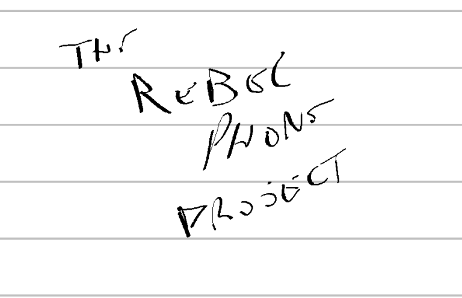
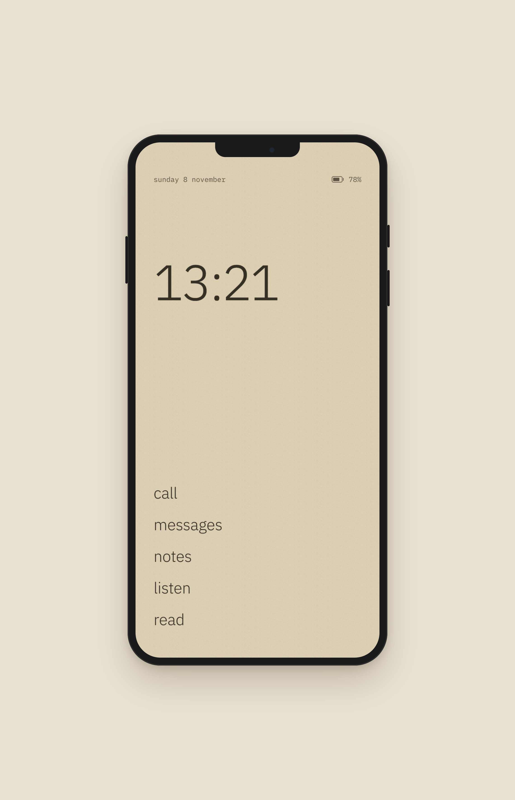

<p align="center">
  
</p>

# The Rebel Phone Project

An attempt to break free from the attention and data stealers that govern
phone technology.

This is a phone where I'm in charge of everything. I decide what it does,
what it shows me, where my data goes and where my attention goes. Nothing on
it was designed to keep me scrolling or to harvest what I do. It's about
sovereignty: owning the device in my pocket instead of renting my attention
to it.

<p align="center">
  
</p>

## Not a product

This isn't meant to be a generic alternative for everybody. It's personal
software, and an experiment to see how far I can go, both technically and
socially: living at the edge of the hyperconnected world. I hope it inspires
others. It also gives proof, and knowledge, of how hard this actually is.

## The real output: agent instructions

The tangible thing I want out of this isn't the code in this repo. It's the
knowledge gained along the way, written down as instructions for coding
agents ([`AGENTS.md`](AGENTS.md), [`docs/`](docs)). With them, anyone can
build their own version, shaped to their own life, without starting from
scratch. Instead of sharing a finished product, this shares the know-how to
build your own: a different take on open source.

That know-how lives in [`docs/know-how/`](docs/know-how/README.md): for each
decision (device and OS, kiosk session, how the UI reaches the system, screen
power, audio, sync, deploys) what I chose, the alternatives, what it cost and
how it was verified. Point your agent at it before it starts; it doesn't need
my code. Agents working on this repo keep it up to date as they go.

How to do this well is still an open question, and one I'll be
investigating: how to write these instructions so agents can work
effectively from them, and help each person shape the personal part, their
own version of the phone, together with them.

## The setup

- **Phone:** a OnePlus 6 running [Nura](https://nura.eco) (formerly postmarketOS), a
  real Linux distribution for phones. In Nura's words: "there is no
  surveillance, no upselling and no 'walled gardens'." No desktop
  environment underneath: this shell *is* the phone.
- **Shell:** a React app in a Chromium kiosk inside `cage`, at a calm
  1080×2280 portrait.
- **Daemon:** a small, dependency-free Node process on the phone. It serves
  the shell and owns all access to the system (battery, screen, audio,
  modem), over HTTP and server-sent events on `127.0.0.1`.
- **The Mac:** where my work lives. The phone and the Mac sync directly,
  peer to peer, with [syncd](https://github.com/nbaglivo/syncd), with no
  cloud in between.

Details in [`docs/architecture.md`](docs/architecture.md) and
[`docs/device.md`](docs/device.md).

## What it does

- **Home:** the time, the day, the battery, and a short list of apps. No
  badges, no red dots, no notifications competing for attention.
- **Call** and **messages:** calls and SMS over the phone's modem.
- **Listen:** music and audiobooks, resuming where I left off, through the
  speaker or headphones.
- **Sync:** I drop music and audiobooks into a folder on my Mac, and they
  show up on the phone.
- **Speak:** tap record, say a thought out loud on a walk, tap stop, pocket
  it. The recording goes to my Mac, gets transcribed on the Mac with
  [Whistle](https://cactuscompute.com/blog/whistle), gets tidied up in my own
  words, and lands in that day's note, ready for when I sit down to write.
- **Power:** the screen blanks and the phone suspends when idle, and stays
  awake while it's playing, recording or syncing.

## Working on it

```sh
npm install
npm run dev          # the shell, http://localhost:5173
npm run build        # static output in dist/
./scripts/deploy.sh  # build, copy to the phone, restart the session
```
